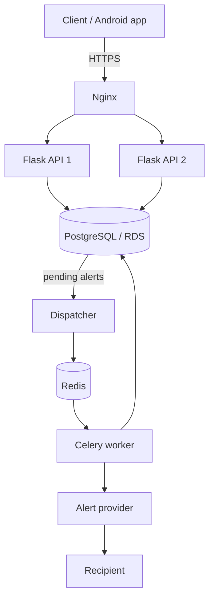

# AI Shield for Her

Flask backend for audio and IoT threat scoring, contact management, incident storage, and durable alert dispatch. The checkout does not contain Android app source or a production notification provider. Current inference uses fixed scoring inputs, so ordinary requests do not reach the incident persistence threshold. See [architecture and behavior](docs/architecture.md) for the exact routes and limits.

## Project layout

| Path | Purpose |
| --- | --- |
| [`app/`](app/) | Flask API, scoring, database access, Celery alerts, and SQL migrations |
| [`assets/models/`](assets/models/) | Trusted toxicity, audio, and Vosk model files; mounted read only into containers |
| [`assets/data/`](assets/data/) | Jigsaw training dataset and archive |
| [`assets/model-assets.sha256`](assets/model-assets.sha256) | Checksums for the model files used at runtime |
| [`deploy/`](deploy/) | Nginx configuration and AWS policy examples |
| [`scripts/`](scripts/) | Deployment, rollback, model verification, and smoke checks |
| [`experiments/`](experiments/) | Manual database/model checks and toxicity training code; not part of the API image |
| [`tests/`](tests/) | Automated API, alert, configuration, and deployment tests |
| [`docs/`](docs/) | Deployment runbook, architecture, verification, and [earlier prototype notes](docs/prototype-notes.md) |
| [`threat-detection-voice/`](https://github.com/Pavanid2325/threat-detection-voice) | Linked voice detection repository (Git submodule) |

The root holds the README, Compose and Docker configuration, Python dependency files, and example environment settings. Runtime uploads stay in the ignored `uploads/` folder locally or in a Docker volume.

## Architecture



Alert delivery uses a fake provider locally. Production alert delivery remains disabled until a real provider is implemented.

## Run locally with Docker

From the repository root, with Docker Desktop running:

```powershell
Copy-Item .env.example .env.local
docker compose --env-file .env.local build
docker compose --env-file .env.local up -d --wait postgres redis
docker compose --env-file .env.local run --rm --no-deps migrate
docker compose --env-file .env.local up -d --wait api1 api2 worker dispatcher nginx
curl.exe --fail http://localhost:8080/health/ready
```

The example `MODEL_ASSET_DIR=./assets/models` matches this layout. To verify the checked in models before loading them, run `python -m scripts.verify_models` from the repository root. For a separate model bundle, set `MODEL_ASSET_DIR` to its directory containing `toxicity/`, `voice_model/`, `scream_model/`, and `vosk-model-small-en-in-0.4/`.

Use a disposable database for integration tests, never real incident data. Full local setup, AWS deployment and rollback are in the [deployment runbook](docs/deployment.md); recorded checks are in [verification results](docs/verification.md).
