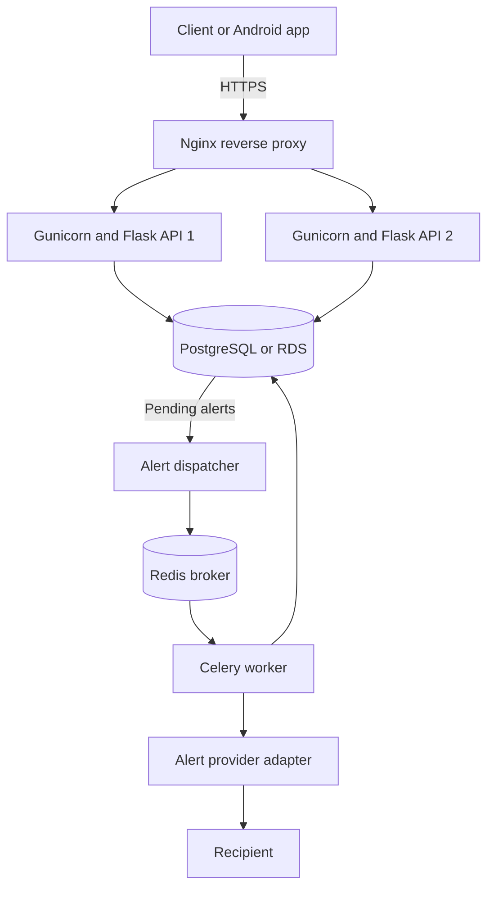

# AI Shield for Her

AI Shield for Her is a Flask backend for audio and IoT threat scoring, emergency contact management, incident storage, and queued alert processing. It runs locally with Docker Compose and includes an AWS deployment workflow. The [voice detection repository](https://github.com/Pavanid2325/threat-detection-voice) is linked as a Git submodule; Android application source is not included here.

> **Current implementation:** The active scoring path uses fixed values and produces a score below the incident storage threshold for ordinary requests. The local alert provider is a simulation and sends no notification. A real provider and verified inference are required before this can be used for emergency delivery. See [architecture and behavior](docs/architecture.md) for the exact limitations.

## Contents

- [Architecture](#architecture)
- [Project structure](#project-structure)
- [Run locally](#run-locally)
- [API overview](#api-overview)
- [Tests and checks](#tests-and-checks)
- [Deployment and documentation](#deployment-and-documentation)

## Architecture



Both API containers use the same application image and database. The dispatcher finds due alert records in PostgreSQL and publishes tasks to Redis. The worker records attempts and outcomes in PostgreSQL. **The included fake provider never contacts a recipient.** In the local stack, Nginx is available at `http://localhost:8080`; production uses TLS and an external PostgreSQL RDS instance. See [architecture and behavior](docs/architecture.md) for alert retries, health checks, data flow, and operational limits.

## Project structure

| Path | Purpose |
| --- | --- |
| [`app/`](app/) | Flask routes, inference, database access, migrations, and alert processing |
| [`app/migrations/`](app/migrations/) | Versioned PostgreSQL schema migrations |
| [`assets/models/`](assets/models/) | Local model artifacts mounted read only into containers |
| [`assets/data/`](assets/data/) | Jigsaw training data for experiments |
| [`assets/model-assets.sha256`](assets/model-assets.sha256) | Checksums for the model assets |
| [`deploy/`](deploy/) | Nginx configuration and AWS policy examples |
| [`scripts/`](scripts/) | Model verification, smoke checks, deployment, and rollback scripts |
| [`experiments/`](experiments/) | Manual model/database checks and training scripts; outside the API image |
| [`tests/`](tests/) | API, alert, configuration, and deployment tests |
| [`docs/`](docs/) | Architecture, runbook, verification results, and prototype notes |
| [Voice detection repository](https://github.com/Pavanid2325/threat-detection-voice) | Separate Git submodule at `threat-detection-voice/` |
| [`.github/workflows/`](.github/workflows/) | CI and deployment workflow |

The root contains the [Dockerfile](Dockerfile), [Compose configuration](compose.yaml), [production Compose overlay](compose.production.yaml), dependency files, and [example environment settings](.env.example). Runtime recordings use an ignored local `uploads/` directory or a Docker volume; they are not source files.

To fetch the linked submodule after cloning:

```powershell
git submodule update --init --recursive
```

## Run locally

**Requirements:** Docker Desktop running Linux containers, Docker Compose 2.24.4 or newer, and the checked in model assets under `assets/models/`. Run these commands from the repository root in PowerShell:

```powershell
Copy-Item .env.example .env.local
docker compose --env-file .env.local build
docker compose --env-file .env.local up -d --wait postgres redis
docker compose --env-file .env.local run --rm --no-deps migrate
docker compose --env-file .env.local up -d --wait api1 api2 worker dispatcher nginx
curl.exe --fail http://localhost:8080/health/ready
```

The [example environment file](.env.example) points `MODEL_ASSET_DIR` to `./assets/models` and enables simulated local alerts. Change local settings in `.env.local`; do not commit runtime credentials. Verify model files before loading them with `python -m scripts.verify_models`. To inspect services, run `docker compose --env-file .env.local ps` and `docker compose --env-file .env.local logs --tail 100 worker dispatcher`.

For Android debugging over USB, `adb reverse tcp:8080 tcp:8080` exposes the local proxy to the device. Android source and device behavior have not been verified in this repository. See the [local startup runbook](docs/deployment.md#local-startup) for smoke checks and the full configuration inventory.

## API overview

| Route | Method | Purpose |
| --- | --- | --- |
| `/health/live`, `/health/ready` | GET | Process and dependency health |
| `/stream_audio` | POST | Accept raw 16 kHz mono PCM16 audio and return scoring results |
| `/iot_data` | POST | Accept sensor data for scoring |
| `/get_contacts`, `/add_contact` | GET, POST | List and create emergency contacts |
| `/update_contact/<id>`, `/delete_contact/<id>` | PUT, DELETE | Update and delete contacts |
| `/get_contacts_by_level/<level>` | GET | List contacts through an escalation level |
| `/get_incidents`, `/delete_incident/<id>` | GET, DELETE | List and delete incidents |
| `/alerts/<incident_id>` | GET | Read aggregate alert status for an incident |
| `/ops/instance`, `/ops/alerts/<incident_id>` | GET | Operator diagnostics; requires a diagnostic token |

The existing client contract uses raw audio in `/stream_audio` with `latitude`, `longitude`, and `accel` query parameters. Audio is saved as WAV before synchronous inference. The response includes `threat_score`, `text`, and `level`, with `incident_id` and `alert_status` when applicable. Optional local API authentication and required production configuration are described in [architecture and behavior](docs/architecture.md#android-integration-boundary) and the [runbook](docs/deployment.md#runtime-configuration-inventory).

## Tests and checks

Python 3.12 is the documented local environment. To run the standard test suite on Windows:

```powershell
py -3.12 -m venv .venv
.\.venv\Scripts\python.exe -m pip install -r requirements.txt -r requirements-test.txt
.\.venv\Scripts\python.exe -m pytest -q
```

Database integration tests are opt in. **They truncate their configured test database**, so use a separate disposable PostgreSQL instance. The [testing runbook](docs/deployment.md#testing) has the required environment variables and isolated service commands. Recorded test and image scan outcomes are in [verification results](docs/verification.md).

## Deployment and documentation

The [CI workflow](.github/workflows/delivery.yml) checks the application and prepares deployment. The [deployment runbook](docs/deployment.md) covers AWS prerequisites, environment settings, model mounts, release steps, backups, and rollback. It does not mean an AWS environment has already been provisioned. Production alert delivery remains disabled until a real provider is implemented and verified.

- [Architecture and observed behavior](docs/architecture.md)
- [Local and AWS deployment runbook](docs/deployment.md)
- [Verification results](docs/verification.md)
- [Earlier prototype notes](docs/prototype-notes.md) — historical design ideas, including alert thresholds and app features that differ from the current backend
