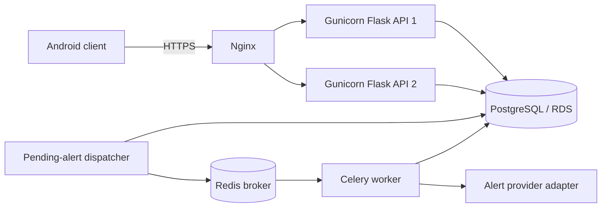

# Repository evidence and resulting architecture

## Evidence before changes

The Git root is this backend directory, one level below the workspace. It already had uncommitted modifications; those were used as the baseline and were not reset. No Android/Gradle/Kotlin/Java sources, authentication middleware, SMS SDK/provider, Docker configuration, CI workflow, dependency manifest, schema migration, or ORM model definition were found. The sibling threat-detection-voice directory is a separate Git checkout; it is not the Android application and was left untouched.

The backend is [server.py](../server.py), previously a module-level Flask app with direct psycopg2 SQL and a hard-coded user_id=1. Its endpoints are `/`, POST `/stream_audio`, POST `/iot_data`, GET `/get_contacts`, POST `/add_contact`, DELETE `/delete_contact/<id>`, PUT `/update_contact/<id>`, GET `/get_contacts_by_level/<level>`, GET `/get_incidents`, DELETE `/delete_incident/<id>`. Contact bodies use name/phone/level. The level-filter endpoint includes levels 1 through the requested level. These routes, methods and existing fields remain.

Audio uploads are HTTP POST raw mono PCM16 little-endian at 16kHz, with latitude, longitude and accel query parameters. They are saved as WAV before synchronous inference; there is no WebSocket, chunked response or streaming HTTP connection. The response preserves threat_score/text/level, with additive incident_id/alert_status. Upload cap is now 10MiB (roughly 327 seconds PCM); clients should continue sending their short recording chunks. Request/error logging omits query strings and bodies.

[stt.py](../stt.py) loads Vosk en-in 0.4, voice/emotion and scream pickle models, and imports the NB-SVM toxicity artifacts. **The active scoring code uses constants** (toxicity .0555, keyword 0, emotion .2, scream 0, IoT .1), producing .083875 regardless of transcript/acceleration. Actual toxicity/emotion/scream calls are commented out. Thresholds in the running server are .005/.02/.05; persistence requires score > .2 and a 15-second cooldown. Consequently normal current inference never persists an incident or requests an alert. The older README's .5/.7/.85 escalation description was aspirational and does not match this implementation. No automatic police dispatch existed. We intentionally preserve this behavior; tests inject higher scores to exercise persistence and dispatch.

The old database helper opened one connection on import and closed it after the first incident, suppressing DB errors. It is replaced with a bounded per-process pool and surfaced failures. The process-local persistence cooldown is now a database-serialized shared cooldown across both replicas. All contact/incident SQL remains parameterized. The new migration bootstraps the schema inferred from queries; an existing database must be inspected/backed up because its original DDL was absent.

## Architecture

One application image runs API, worker, dispatcher and one-off migration commands. Local PostgreSQL/Redis/recordings use named volumes. Production removes PostgreSQL from the default service set and connects to private RDS with verify-full TLS. EC2 hosts Nginx, both APIs, Redis, Celery and the dispatcher. Two APIs distribute traffic and survive a process/container failure; **EC2 is still a single host failure point**. EC2 loss interrupts processing until recovery; RDS and its backups protect committed outbox records. Recordings require separate backup because the current shared volume is on EC2.

## Alert semantics

The incident, recipient snapshots, stable incident/contact idempotency keys and cooldown commit atomically. The API never publishes to Redis during that transaction. The dispatcher scans due rows every five seconds; it does not treat publication as delivery. Successful publication starts a 30-second dispatch lease, bounding repeated enqueueing while workers are busy. Lost broker messages become eligible again after that lease. Publication failure leaves the record eligible, and provider retry transitions clear the publication lease so backoff remains effective. Broker loss, lost broker data and duplicate publication recover by scanning again. Tasks carry only integer alert identifiers. Contacts are selected cumulatively by incident level. No contacts means not_requested. ALERTS_ENABLED defaults to opt-in fake development behavior in the example; without that setting, the legacy behavior creates incidents only.

Delivery obtains a PostgreSQL session advisory lock per alert before examining durable state. It commits the incremented attempt and processing lease before provider I/O; a second simultaneous task exits. Attempt history survives worker termination, with interrupted attempts recorded on recovery. Five attempts maximum, delays 2/4/8/16 seconds before terminal failure, and a 90-second recovery lease for interrupted work. Celery soft/hard limits are 25/30 seconds and Redis visibility timeout is 120 seconds. A future provider must use connect/read timeouts whose total fits below the soft limit (e.g. 3/10 seconds), pass the stable idempotency key where supported, and treat only a documented positive provider acknowledgement as accepted delivery. The fake provider performs no I/O. Real transport exceptions must never be logged verbatim.

**No production provider exists in this checkout.** Production requires ALERTS_ENABLED=false until an actual adapter and integration tests replace the fail-closed guard. A fake success is a test outcome, not an emergency notification. Provider acceptance also may not mean handset receipt; adapt status labels to the actual provider contract before launch. If a provider accepts a send but the worker dies before recording its response, a retry may duplicate delivery when the provider does not support durable idempotency. There is no exactly-once or guaranteed emergency delivery claim.

The additive `/alerts/<incident_id>` endpoint returns counts by durable status, protected by the normal API token when configured. `/ops/alerts/<incident_id>` is an operator equivalent. The upload response's alert_status is not_requested, pending, delivered or failed; pending includes queued/retrying/processing. Never show pending as delivered in Android. Mixed terminal successes/failures have failed aggregate status; counts retain detail.

## Operations and resource budgets

Liveness is process-only. Readiness checks the PostgreSQL connection and migrated gate, plus model initialization; Redis failure leaves the API ready because alert intent still commits durably. It does degrade alert latency: dispatcher heartbeat and queue age must be monitored separately. PostgreSQL connect timeout is 3 seconds, SQL statement timeout 5 seconds and lock timeout 2 seconds. Dispatcher health requires a successful scan/publication loop in the last 30 seconds; worker health uses a targeted ping. Deployment smoke adds a harmless worker-to-database round-trip. Health responses expose no exceptions, credentials or topology. Authenticated `/ops/instance` reports only a logical instance name and release SHA.

Default Gunicorn configuration is **one synchronous worker per API**, with numerical libraries limited to one native thread, 120-second request timeout, 125-second graceful timeout and 135-second container stop grace. Every API process loads its own Vosk and pickle models; spawning CPU-count workers would multiply memory and compete for inference CPU. A generated one-second silent sample in Linux peaked near 335 MiB RSS per process; this is only a smoke measurement, not representative production capacity. Before sizing EC2, benchmark representative chunk duration at two concurrent requests, record peak RSS and p95, and leave memory headroom for Redis/OS/workers. Increase concurrency only after measuring. Workers never load audio models. Celery has two prefork processes.

Pool maximum 2 per process gives 2 APIs x 1 worker x 2 = 4 DB connections; Celery children 2 x 2 = 4; dispatcher 2; migration 2; transient smoke 2; reserve at least 5 more administrative connections: budget at least **19**. Raising Gunicorn/Celery concurrency requires recalculation and an RDS max_connections budget. Connections validate with SELECT 1; checkout discards a broken connection and retries once before running application SQL. Mutating queries themselves are never automatically replayed. Application errors close request-owned connections during teardown.

ProxyFix trusts exactly one hop only when TRUST_PROXY=true. API port 5000 has no host publication, so Nginx is the only public ingress. Nginx overwrites forwarded headers. Do not add an unaccounted-for proxy or expose API ports. DNS resolve/zone uses supported open-source Nginx behavior (>=1.27.3), refreshed at 5 seconds; GET failures may fail over, while POST requests are not replayed after sending upstream. See [Nginx upstream documentation](https://nginx.org/en/docs/http/ngx_http_upstream_module.html) and [Celery configuration](https://docs.celeryq.dev/en/stable/userguide/configuration.html).

Logs are JSON application events to stdout/stderr with sanitized correlation IDs and release identifiers. Nginx logs method/path/status only. API correlation travels into persisted alerts; retries/outcomes record it without recipient/GPS/transcript content. Docker rotates at 10MiB x 3 per service. Worker events use WARNING loglevel to avoid Celery's task/result logging; delivery events use the shield logger. Retention/alerting for oldest pending record, failed count, dispatcher heartbeat, RDS utilization and EC2 disk/memory remains an operator setup task.

## Android integration boundary

Android source is missing, so no client compilation or device connectivity was verified. Use the application's existing build configuration for debug URL `http://127.0.0.1:8080/` with `adb reverse tcp:8080 tcp:8080`; use `https://YOUR_DNS_NAME/` for production and disallow cleartext in release builds. A physical LAN device needs a deliberately exposed development proxy or tunnel; the default port binds only to localhost. Keep raw PCM and existing query/body names. Add Authorization: Bearer API_TOKEN if server authentication is enabled. Poll `/alerts/<incident_id>` only when an incident_id exists. Do not embed the operator token, AWS credentials or DB credentials in Android. The server token is a deployment gate, not per-user identity or authorization; the repository has no user authentication implementation. Recover Android sources and integrate a real user identity mechanism before public multi-user operation.
